# Bảng toạ độ các màn (tự sinh — đừng sửa tay, sửa `gen-wireframes.mjs`)

Đơn vị pt (= CSS px), gốc (0,0) góc trên-trái khung. Vùng an toàn = khung đỏ nét đứt trong SVG.

## 00-components — Thành phần dùng chung (kích thước chuẩn)
Khung 844×390 · an toàn trái 48 phải 48 trên 8 dưới 20 · 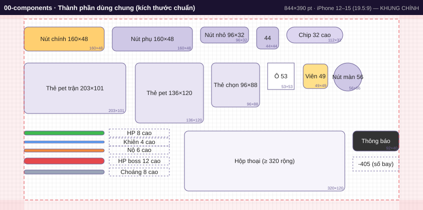

| id | x | y | w | h | loại | nội dung |
|---|---|---|---|---|---|---|
| btn.primary | 48 | 24 | 160 | 48 | primary | Nút chính 160×48 |
| btn.secondary | 224 | 24 | 160 | 48 | btn | Nút phụ 160×48 |
| btn.small | 400 | 24 | 96 | 32 | btn | Nút nhỏ 96×32 |
| btn.icon | 512 | 24 | 44 | 44 | btn | 44 |
| chip | 572 | 24 | 112 | 32 | chip | Chip 32 cao |
| card.battlePet | 48 | 96 | 203 | 101 | panel | Thẻ pet trận 203×101 |
| card.pet | 270 | 96 | 136 | 120 | panel | Thẻ pet 136×120 |
| card.pick | 422 | 96 | 96 | 88 | panel | Thẻ chọn 96×88 |
| gem.cell | 534 | 96 | 53 | 53 | cell | Ô 53 |
| gem | 605 | 98 | 49 | 49 | gem | Viên 49 |
| map.node | 666 | 96 | 56 | 56 | node | Nút màn 56 |
| bar.hp | 48 | 232 | 160 | 8 | bar-hp |  |
| bar.shield | 48 | 252 | 160 | 4 | bar-sh |  |
| bar.rage | 48 | 268 | 160 | 6 | bar-rage |  |
| bar.boss | 48 | 286 | 160 | 12 | bar-boss |  |
| bar.stun | 48 | 310 | 160 | 8 | bar-stun |  |
| modal | 368 | 232 | 320 | 120 | modal | Hộp thoại (≥ 320 rộng) |
| toast | 704 | 232 | 92 | 40 | toast | Thông báo |
| float | 704 | 284 | 92 | 28 | text | -405 (số bay) |

## 01-start — Bắt đầu / Tải
Khung 844×390 · an toàn trái 48 phải 48 trên 8 dưới 20 · 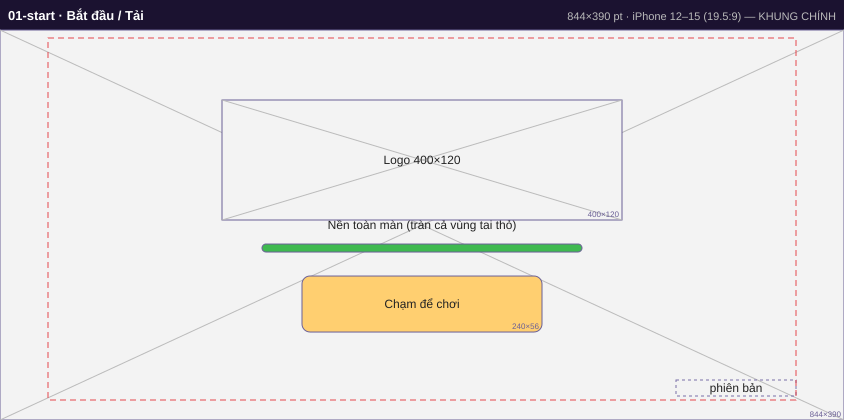

| id | x | y | w | h | loại | nội dung |
|---|---|---|---|---|---|---|
| start.bg | 0 | 0 | 844 | 390 | img | Nền toàn màn (tràn cả vùng tai thỏ) |
| start.logo | 222 | 70 | 400 | 120 | img | Logo 400×120 |
| start.loading | 262 | 214 | 320 | 8 | bar-hp |  |
| start.tap | 302 | 246 | 240 | 56 | primary | Chạm để chơi |
| start.version | 676 | 350 | 120 | 16 | text | phiên bản |

## 02-home — Trang chủ (sảnh) — khung giãn theo màn hình, neo mép
Khung 844×390 · an toàn trái 48 phải 48 trên 8 dưới 20 · 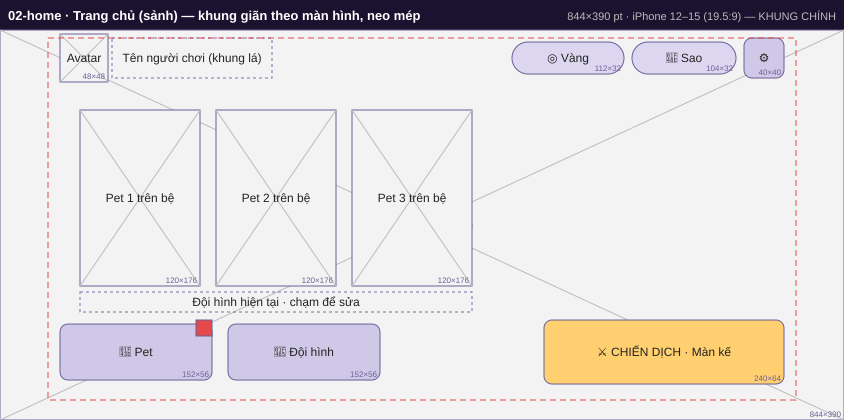

| id | x | y | w | h | loại | nội dung |
|---|---|---|---|---|---|---|
| home.bg | 0 | 0 | 844 | 390 | img | Nền sảnh (phủ kín) |
| home.avatar | 60 | 4 | 48 | 48 | img | Avatar |
| home.name | 112 | 8 | 160 | 40 | text | Tên người chơi (khung lá) |
| topbar.settings | 744 | 8 | 40 | 40 | btn | ⚙ |
| topbar.stars | 632 | 12 | 104 | 32 | chip | 💎 Sao |
| topbar.gold | 512 | 12 | 112 | 32 | chip | ◎ Vàng |
| home.pet1 | 80 | 80 | 120 | 176 | img | Pet 1 trên bệ |
| home.pet2 | 216 | 80 | 120 | 176 | img | Pet 2 trên bệ |
| home.pet3 | 352 | 80 | 120 | 176 | img | Pet 3 trên bệ |
| home.teamLabel | 80 | 262 | 392 | 20 | text | Đội hình hiện tại · chạm để sửa |
| home.pets | 60 | 294 | 152 | 56 | btn | 🐾 Pet |
| home.team | 228 | 294 | 152 | 56 | btn | 👥 Đội hình |
| home.pets.badge | 196 | 290 | 16 | 16 | badge |  |
| home.campaign | 544 | 290 | 240 | 64 | primary | ⚔ CHIẾN DỊCH · Màn kế |

## 03-campaign-map — Bản đồ chương
Khung 844×390 · an toàn trái 48 phải 48 trên 8 dưới 20 · 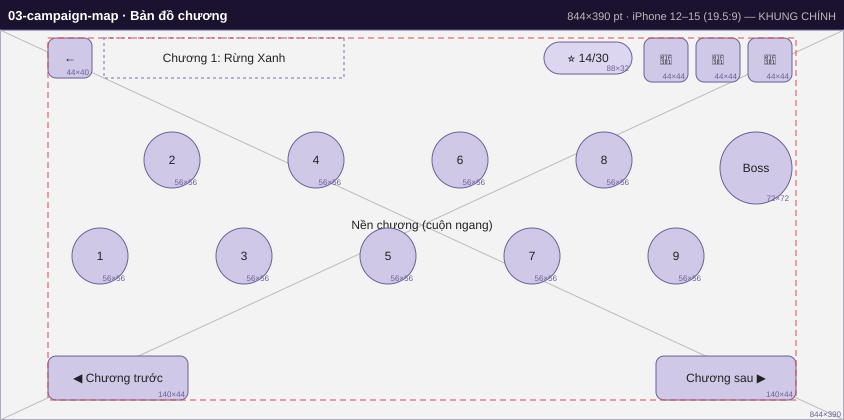

| id | x | y | w | h | loại | nội dung |
|---|---|---|---|---|---|---|
| map.bg | 0 | 0 | 844 | 390 | img | Nền chương (cuộn ngang) |
| topbar.back | 48 | 8 | 44 | 40 | btn | ← |
| map.title | 104 | 8 | 240 | 40 | text | Chương 1: Rừng Xanh |
| map.stars | 544 | 12 | 88 | 32 | chip | ⭐ 14/30 |
| map.chest1 | 644 | 8 | 44 | 44 | btn | 🎁 |
| map.chest2 | 696 | 8 | 44 | 44 | btn | 🎁 |
| map.chest3 | 748 | 8 | 44 | 44 | btn | 🎁 |
| map.node1 | 72 | 198 | 56 | 56 | node | 1 |
| map.node2 | 144 | 102 | 56 | 56 | node | 2 |
| map.node3 | 216 | 198 | 56 | 56 | node | 3 |
| map.node4 | 288 | 102 | 56 | 56 | node | 4 |
| map.node5 | 360 | 198 | 56 | 56 | node | 5 |
| map.node6 | 432 | 102 | 56 | 56 | node | 6 |
| map.node7 | 504 | 198 | 56 | 56 | node | 7 |
| map.node8 | 576 | 102 | 56 | 56 | node | 8 |
| map.node9 | 648 | 198 | 56 | 56 | node | 9 |
| map.node10 | 720 | 102 | 72 | 72 | node | Boss |
| map.prev | 48 | 326 | 140 | 44 | btn | ◀ Chương trước |
| map.next | 656 | 326 | 140 | 44 | btn | Chương sau ▶ |

## 04-stage-info — Thông tin màn (hộp thoại)
Khung 844×390 · an toàn trái 48 phải 48 trên 8 dưới 20 · 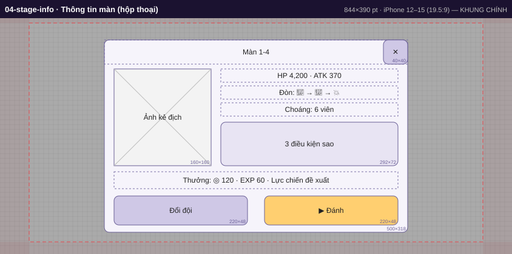

| id | x | y | w | h | loại | nội dung |
|---|---|---|---|---|---|---|
| stage.modal | 172 | 36 | 500 | 318 | modal |  |
| stage.title | 172 | 36 | 500 | 40 | text | Màn 1-4 |
| stage.enemy | 188 | 84 | 160 | 160 | img | Ảnh kẻ địch |
| stage.stats | 364 | 84 | 292 | 22 | text | HP 4,200 · ATK 370 |
| stage.pattern | 364 | 112 | 292 | 22 | text | Đòn: 🎯 → 🎯 → 💥 |
| stage.stun | 364 | 140 | 292 | 22 | text | Choáng: 6 viên |
| stage.starRules | 364 | 172 | 292 | 72 | panel | 3 điều kiện sao |
| stage.reward | 188 | 254 | 468 | 28 | text | Thưởng: ◎ 120 · EXP 60 · Lực chiến đề xuất |
| stage.team | 188 | 294 | 220 | 48 | btn | Đổi đội |
| stage.fight | 436 | 294 | 220 | 48 | primary | ▶ Đánh |
| stage.close | 632 | 36 | 40 | 40 | btn | ✕ |

## 05-team — Đội hình — trái: 3 ô cột (trên→dưới) · phải: kho pet + boss
Khung 844×390 · an toàn trái 48 phải 48 trên 8 dưới 20 · 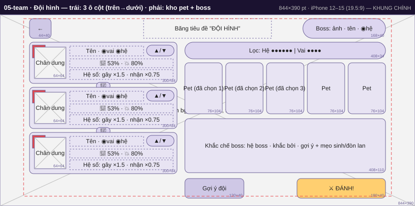

| id | x | y | w | h | loại | nội dung |
|---|---|---|---|---|---|---|
| team.bg | 0 | 0 | 844 | 390 | img | Nền bg_pet (mờ 5px, tối 80%) |
| topbar.back | 60 | 8 | 44 | 40 | btn | ← |
| team.title | 292 | 8 | 260 | 40 | text | Băng tiêu đề "ĐỘI HÌNH" |
| team.boss | 616 | 8 | 168 | 40 | chip | Boss: ảnh · tên · ◉hệ |
| team.slot1 | 60 | 56 | 300 | 84 | panel |  |
| team.slot1.no | 66 | 62 | 26 | 26 | badge | 1 |
| team.slot1.art | 70 | 66 | 64 | 64 | img | Chân dung |
| team.slot1.name | 142 | 64 | 150 | 20 | text | Tên · ◉vai ◉hệ |
| team.slot1.adv | 298 | 62 | 56 | 22 | chip | ▲/▼ |
| team.slot1.aggro | 142 | 90 | 210 | 18 | text | 🎯 53%  ·  💥 80% |
| team.slot1.mods | 142 | 112 | 210 | 20 | text | Hệ số: gây ×1.5 · nhận ×0.75 |
| team.link1 | 196 | 138 | 28 | 14 | chip | 🌱 |
| team.slot2 | 60 | 148 | 300 | 84 | panel |  |
| team.slot2.no | 66 | 154 | 26 | 26 | badge | 2 |
| team.slot2.art | 70 | 158 | 64 | 64 | img | Chân dung |
| team.slot2.name | 142 | 156 | 150 | 20 | text | Tên · ◉vai ◉hệ |
| team.slot2.adv | 298 | 154 | 56 | 22 | chip | ▲/▼ |
| team.slot2.aggro | 142 | 182 | 210 | 18 | text | 🎯 53%  ·  💥 80% |
| team.slot2.mods | 142 | 204 | 210 | 20 | text | Hệ số: gây ×1.5 · nhận ×0.75 |
| team.link2 | 196 | 230 | 28 | 14 | chip | 🌱 |
| team.slot3 | 60 | 240 | 300 | 84 | panel |  |
| team.slot3.no | 66 | 246 | 26 | 26 | badge | 3 |
| team.slot3.art | 70 | 250 | 64 | 64 | img | Chân dung |
| team.slot3.name | 142 | 248 | 150 | 20 | text | Tên · ◉vai ◉hệ |
| team.slot3.adv | 298 | 246 | 56 | 22 | chip | ▲/▼ |
| team.slot3.aggro | 142 | 274 | 210 | 18 | text | 🎯 53%  ·  💥 80% |
| team.slot3.mods | 142 | 296 | 210 | 20 | text | Hệ số: gây ×1.5 · nhận ×0.75 |
| team.filter | 376 | 56 | 408 | 34 | chip | Lọc: Hệ ●●●●●● | Vai ●●●● |
| team.pool1 | 376 | 98 | 76 | 104 | panel | Pet (đã chọn 1) |
| team.pool2 | 459 | 98 | 76 | 104 | panel | Pet (đã chọn 2) |
| team.pool3 | 542 | 98 | 76 | 104 | panel | Pet (đã chọn 3) |
| team.pool4 | 625 | 98 | 76 | 104 | panel | Pet |
| team.pool5 | 708 | 98 | 76 | 104 | panel | Pet |
| team.hint | 376 | 212 | 408 | 110 | panel | Khắc chế boss: hệ boss · khắc bởi · gợi ý + mẹo sinh/đòn lan |
| team.auto | 376 | 334 | 120 | 40 | btn | Gợi ý đội |
| team.fight | 604 | 334 | 180 | 40 | primary | ⚔ ĐÁNH! |

## 06-battle — Chiến đấu — khung chính
Khung 844×390 · an toàn trái 48 phải 48 trên 8 dưới 20 · 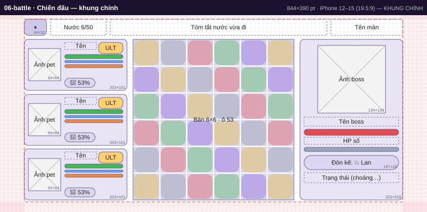

| id | x | y | w | h | loại | nội dung |
|---|---|---|---|---|---|---|
| battle.pause | 48 | 8 | 44 | 32 | btn | ⏸ |
| battle.moves | 100 | 8 | 110 | 32 | text | Nước 6/50 |
| battle.summary | 218 | 8 | 428 | 32 | text | Tóm tắt nước vừa đi |
| battle.stage | 654 | 8 | 142 | 32 | text | Tên màn |
| battle.board | 263 | 48 | 318 | 318 | board | Bàn 6×6 · ô 53 |
| battle.pet1 | 48 | 48 | 203 | 101 | panel |  |
| battle.pet1.art | 56 | 66 | 64 | 64 | img | Ảnh pet |
| battle.pet1.name | 128 | 54 | 63 | 14 | text | Tên |
| battle.pet1.ult | 195 | 54 | 48 | 22 | primary | ULT |
| battle.pet1.hp | 128 | 78 | 115 | 8 | bar-hp |  |
| battle.pet1.shield | 128 | 90 | 115 | 4 | bar-sh |  |
| battle.pet1.rage | 128 | 98 | 115 | 6 | bar-rage |  |
| battle.pet1.aggro | 128 | 125 | 60 | 18 | chip | 🎯 53% |
| battle.pet2 | 48 | 157 | 203 | 101 | panel |  |
| battle.pet2.art | 56 | 175 | 64 | 64 | img | Ảnh pet |
| battle.pet2.name | 128 | 163 | 63 | 14 | text | Tên |
| battle.pet2.ult | 195 | 163 | 48 | 22 | primary | ULT |
| battle.pet2.hp | 128 | 187 | 115 | 8 | bar-hp |  |
| battle.pet2.shield | 128 | 199 | 115 | 4 | bar-sh |  |
| battle.pet2.rage | 128 | 207 | 115 | 6 | bar-rage |  |
| battle.pet2.aggro | 128 | 233 | 60 | 18 | chip | 🎯 53% |
| battle.pet3 | 48 | 265 | 203 | 101 | panel |  |
| battle.pet3.art | 56 | 284 | 64 | 64 | img | Ảnh pet |
| battle.pet3.name | 128 | 271 | 63 | 14 | text | Tên |
| battle.pet3.ult | 195 | 271 | 48 | 22 | primary | ULT |
| battle.pet3.hp | 128 | 295 | 115 | 8 | bar-hp |  |
| battle.pet3.shield | 128 | 307 | 115 | 4 | bar-sh |  |
| battle.pet3.rage | 128 | 315 | 115 | 6 | bar-rage |  |
| battle.pet3.aggro | 128 | 342 | 60 | 18 | chip | 🎯 53% |
| battle.boss | 593 | 48 | 203 | 318 | panel |  |
| battle.boss.art | 628 | 60 | 134 | 134 | img | Ảnh boss |
| battle.boss.name | 601 | 202 | 187 | 18 | text | Tên boss |
| battle.boss.hp | 601 | 226 | 187 | 12 | bar-boss |  |
| battle.boss.hpText | 601 | 242 | 187 | 14 | text | HP số |
| battle.boss.stun | 601 | 262 | 187 | 8 | bar-stun | Choáng (n ô) |
| battle.boss.next | 601 | 278 | 187 | 28 | chip | Đòn kế: 💥 Lan |
| battle.boss.status | 601 | 312 | 187 | 20 | text | Trạng thái (choáng…) |

## 06b-battle-16x9 — Chiến đấu — 667×375 (16:9)
Khung 667×375 · an toàn trái 16 phải 16 trên 8 dưới 8 · 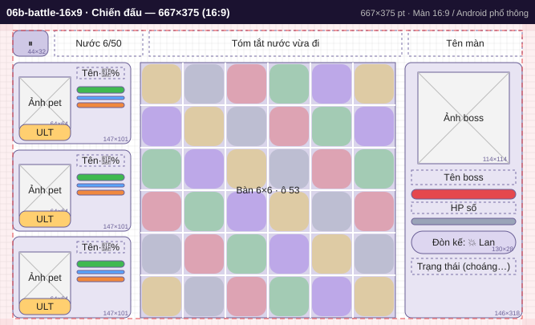

| id | x | y | w | h | loại | nội dung |
|---|---|---|---|---|---|---|
| battle.pause | 16 | 8 | 44 | 32 | btn | ⏸ |
| battle.moves | 68 | 8 | 110 | 32 | text | Nước 6/50 |
| battle.summary | 186 | 8 | 315 | 32 | text | Tóm tắt nước vừa đi |
| battle.stage | 509 | 8 | 142 | 32 | text | Tên màn |
| battle.board | 175 | 48 | 318 | 318 | board | Bàn 6×6 · ô 53 |
| battle.pet1 | 16 | 48 | 147 | 101 | panel |  |
| battle.pet1.art | 24 | 66 | 64 | 64 | img | Ảnh pet |
| battle.pet1.name | 96 | 54 | 59 | 14 | text | Tên·🎯% |
| battle.pet1.ult | 24 | 125 | 64 | 20 | primary | ULT |
| battle.pet1.hp | 96 | 78 | 59 | 8 | bar-hp |  |
| battle.pet1.shield | 96 | 90 | 59 | 4 | bar-sh |  |
| battle.pet1.rage | 96 | 98 | 59 | 6 | bar-rage |  |
| battle.pet2 | 16 | 157 | 147 | 101 | panel |  |
| battle.pet2.art | 24 | 175 | 64 | 64 | img | Ảnh pet |
| battle.pet2.name | 96 | 163 | 59 | 14 | text | Tên·🎯% |
| battle.pet2.ult | 24 | 233 | 64 | 20 | primary | ULT |
| battle.pet2.hp | 96 | 187 | 59 | 8 | bar-hp |  |
| battle.pet2.shield | 96 | 199 | 59 | 4 | bar-sh |  |
| battle.pet2.rage | 96 | 207 | 59 | 6 | bar-rage |  |
| battle.pet3 | 16 | 265 | 147 | 101 | panel |  |
| battle.pet3.art | 24 | 284 | 64 | 64 | img | Ảnh pet |
| battle.pet3.name | 96 | 271 | 59 | 14 | text | Tên·🎯% |
| battle.pet3.ult | 24 | 342 | 64 | 20 | primary | ULT |
| battle.pet3.hp | 96 | 295 | 59 | 8 | bar-hp |  |
| battle.pet3.shield | 96 | 307 | 59 | 4 | bar-sh |  |
| battle.pet3.rage | 96 | 315 | 59 | 6 | bar-rage |  |
| battle.boss | 505 | 48 | 146 | 318 | panel |  |
| battle.boss.art | 521 | 60 | 114 | 114 | img | Ảnh boss |
| battle.boss.name | 513 | 182 | 130 | 18 | text | Tên boss |
| battle.boss.hp | 513 | 206 | 130 | 12 | bar-boss |  |
| battle.boss.hpText | 513 | 222 | 130 | 14 | text | HP số |
| battle.boss.stun | 513 | 242 | 130 | 8 | bar-stun | Choáng (n ô) |
| battle.boss.next | 513 | 258 | 130 | 28 | chip | Đòn kế: 💥 Lan |
| battle.boss.status | 513 | 292 | 130 | 20 | text | Trạng thái (choáng…) |

## 06c-battle-small — Chiến đấu — 568×320 (nhỏ nhất)
Khung 568×320 · an toàn trái 16 phải 16 trên 8 dưới 8 · 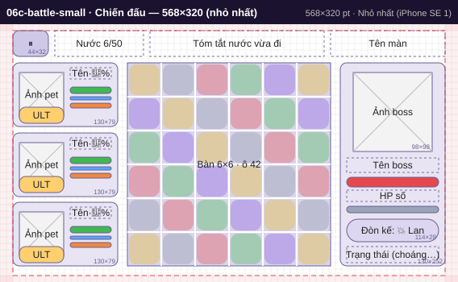

| id | x | y | w | h | loại | nội dung |
|---|---|---|---|---|---|---|
| battle.pause | 16 | 8 | 44 | 32 | btn | ⏸ |
| battle.moves | 68 | 8 | 110 | 32 | text | Nước 6/50 |
| battle.summary | 186 | 8 | 216 | 32 | text | Tóm tắt nước vừa đi |
| battle.stage | 410 | 8 | 142 | 32 | text | Tên màn |
| battle.board | 158 | 48 | 252 | 252 | board | Bàn 6×6 · ô 42 |
| battle.pet1 | 16 | 48 | 130 | 79 | panel |  |
| battle.pet1.art | 24 | 60 | 55 | 55 | img | Ảnh pet |
| battle.pet1.name | 87 | 54 | 51 | 14 | text | Tên·🎯% |
| battle.pet1.ult | 24 | 103 | 55 | 20 | primary | ULT |
| battle.pet1.hp | 87 | 78 | 51 | 8 | bar-hp |  |
| battle.pet1.shield | 87 | 90 | 51 | 4 | bar-sh |  |
| battle.pet1.rage | 87 | 98 | 51 | 6 | bar-rage |  |
| battle.pet2 | 16 | 135 | 130 | 79 | panel |  |
| battle.pet2.art | 24 | 147 | 55 | 55 | img | Ảnh pet |
| battle.pet2.name | 87 | 141 | 51 | 14 | text | Tên·🎯% |
| battle.pet2.ult | 24 | 189 | 55 | 20 | primary | ULT |
| battle.pet2.hp | 87 | 165 | 51 | 8 | bar-hp |  |
| battle.pet2.shield | 87 | 177 | 51 | 4 | bar-sh |  |
| battle.pet2.rage | 87 | 185 | 51 | 6 | bar-rage |  |
| battle.pet3 | 16 | 221 | 130 | 79 | panel |  |
| battle.pet3.art | 24 | 233 | 55 | 55 | img | Ảnh pet |
| battle.pet3.name | 87 | 227 | 51 | 14 | text | Tên·🎯% |
| battle.pet3.ult | 24 | 276 | 55 | 20 | primary | ULT |
| battle.pet3.hp | 87 | 251 | 51 | 8 | bar-hp |  |
| battle.pet3.shield | 87 | 263 | 51 | 4 | bar-sh |  |
| battle.pet3.rage | 87 | 271 | 51 | 6 | bar-rage |  |
| battle.boss | 422 | 48 | 130 | 252 | panel |  |
| battle.boss.art | 438 | 60 | 98 | 98 | img | Ảnh boss |
| battle.boss.name | 430 | 166 | 114 | 18 | text | Tên boss |
| battle.boss.hp | 430 | 190 | 114 | 12 | bar-boss |  |
| battle.boss.hpText | 430 | 206 | 114 | 14 | text | HP số |
| battle.boss.stun | 430 | 226 | 114 | 8 | bar-stun | Choáng (n ô) |
| battle.boss.next | 430 | 242 | 114 | 28 | chip | Đòn kế: 💥 Lan |
| battle.boss.status | 430 | 276 | 114 | 20 | text | Trạng thái (choáng…) |

## 06d-battle-wide — Chiến đấu — 932×430 (Pro Max)
Khung 932×430 · an toàn trái 59 phải 59 trên 8 dưới 21 · 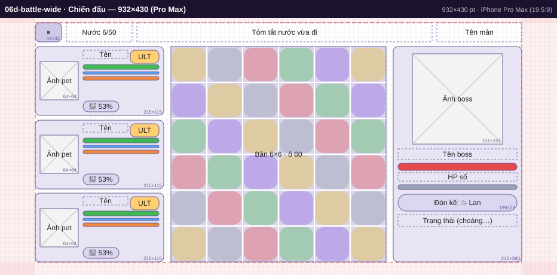

| id | x | y | w | h | loại | nội dung |
|---|---|---|---|---|---|---|
| battle.pause | 59 | 8 | 44 | 32 | btn | ⏸ |
| battle.moves | 111 | 8 | 110 | 32 | text | Nước 6/50 |
| battle.summary | 229 | 8 | 494 | 32 | text | Tóm tắt nước vừa đi |
| battle.stage | 731 | 8 | 142 | 32 | text | Tên màn |
| battle.board | 286 | 48 | 360 | 360 | board | Bàn 6×6 · ô 60 |
| battle.pet1 | 59 | 48 | 215 | 115 | panel |  |
| battle.pet1.art | 67 | 73 | 64 | 64 | img | Ảnh pet |
| battle.pet1.name | 139 | 54 | 75 | 14 | text | Tên |
| battle.pet1.ult | 218 | 54 | 48 | 22 | primary | ULT |
| battle.pet1.hp | 139 | 78 | 127 | 8 | bar-hp |  |
| battle.pet1.shield | 139 | 90 | 127 | 4 | bar-sh |  |
| battle.pet1.rage | 139 | 98 | 127 | 6 | bar-rage |  |
| battle.pet1.aggro | 139 | 139 | 60 | 18 | chip | 🎯 53% |
| battle.pet2 | 59 | 171 | 215 | 115 | panel |  |
| battle.pet2.art | 67 | 196 | 64 | 64 | img | Ảnh pet |
| battle.pet2.name | 139 | 177 | 75 | 14 | text | Tên |
| battle.pet2.ult | 218 | 177 | 48 | 22 | primary | ULT |
| battle.pet2.hp | 139 | 201 | 127 | 8 | bar-hp |  |
| battle.pet2.shield | 139 | 213 | 127 | 4 | bar-sh |  |
| battle.pet2.rage | 139 | 221 | 127 | 6 | bar-rage |  |
| battle.pet2.aggro | 139 | 261 | 60 | 18 | chip | 🎯 53% |
| battle.pet3 | 59 | 293 | 215 | 115 | panel |  |
| battle.pet3.art | 67 | 319 | 64 | 64 | img | Ảnh pet |
| battle.pet3.name | 139 | 299 | 75 | 14 | text | Tên |
| battle.pet3.ult | 218 | 299 | 48 | 22 | primary | ULT |
| battle.pet3.hp | 139 | 323 | 127 | 8 | bar-hp |  |
| battle.pet3.shield | 139 | 335 | 127 | 4 | bar-sh |  |
| battle.pet3.rage | 139 | 343 | 127 | 6 | bar-rage |  |
| battle.pet3.aggro | 139 | 384 | 60 | 18 | chip | 🎯 53% |
| battle.boss | 658 | 48 | 215 | 360 | panel |  |
| battle.boss.art | 690 | 60 | 151 | 151 | img | Ảnh boss |
| battle.boss.name | 666 | 219 | 199 | 18 | text | Tên boss |
| battle.boss.hp | 666 | 243 | 199 | 12 | bar-boss |  |
| battle.boss.hpText | 666 | 259 | 199 | 14 | text | HP số |
| battle.boss.stun | 666 | 279 | 199 | 8 | bar-stun | Choáng (n ô) |
| battle.boss.next | 666 | 295 | 199 | 28 | chip | Đòn kế: 💥 Lan |
| battle.boss.status | 666 | 329 | 199 | 20 | text | Trạng thái (choáng…) |

## 07-result — Kết quả
Khung 844×390 · an toàn trái 48 phải 48 trên 8 dưới 20 · 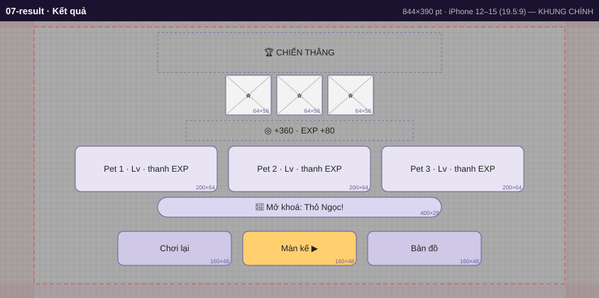

| id | x | y | w | h | loại | nội dung |
|---|---|---|---|---|---|---|
| result.title | 222 | 16 | 400 | 56 | text | 🏆 CHIẾN THẮNG |
| result.star1 | 318 | 76 | 64 | 56 | img | ⭐ |
| result.star2 | 390 | 76 | 64 | 56 | img | ⭐ |
| result.star3 | 462 | 76 | 64 | 56 | img | ⭐ |
| result.reward | 262 | 140 | 320 | 28 | text | ◎ +360 · EXP +80 |
| result.pet1 | 106 | 176 | 200 | 64 | panel | Pet 1 · Lv · thanh EXP |
| result.pet2 | 322 | 176 | 200 | 64 | panel | Pet 2 · Lv · thanh EXP |
| result.pet3 | 538 | 176 | 200 | 64 | panel | Pet 3 · Lv · thanh EXP |
| result.unlock | 222 | 248 | 400 | 28 | chip | 🐾 Mở khoá: Thỏ Ngọc! |
| result.retry | 166 | 296 | 160 | 48 | btn | Chơi lại |
| result.next | 342 | 296 | 160 | 48 | primary | Màn kế ▶ |
| result.map | 518 | 296 | 160 | 48 | btn | Bản đồ |

## 08-pet-list — Bộ sưu tập pet — nền mờ, lọc Hệ/Vai, phân trang 5/trang
Khung 844×390 · an toàn trái 48 phải 48 trên 8 dưới 20 · 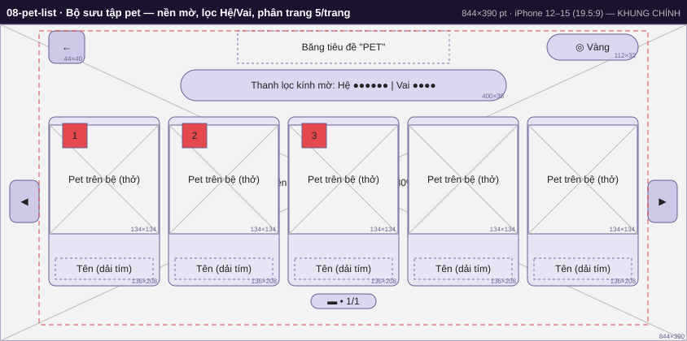

| id | x | y | w | h | loại | nội dung |
|---|---|---|---|---|---|---|
| pets.bg | 0 | 0 | 844 | 390 | img | Nền bg_pet (làm mờ 5px, tối 80%) |
| topbar.back | 60 | 8 | 44 | 40 | btn | ← |
| pets.title | 292 | 8 | 260 | 40 | text | Băng tiêu đề "PET" |
| topbar.gold | 672 | 12 | 112 | 32 | chip | ◎ Vàng |
| pets.filter | 222 | 56 | 400 | 38 | chip | Thanh lọc kính mờ: Hệ ●●●●●● | Vai ●●●● |
| pets.prev | 12 | 192 | 36 | 52 | btn | ◀ |
| pets.card1 | 60 | 114 | 136 | 208 | panel |  |
| pets.card1.art | 61 | 124 | 134 | 134 | img | Pet trên bệ (thở) |
| pets.card1.name | 68 | 288 | 120 | 26 | text | Tên (dải tím) |
| pets.card1.slot | 77 | 122 | 30 | 30 | badge | 1 |
| pets.card2 | 207 | 114 | 136 | 208 | panel |  |
| pets.card2.art | 208 | 124 | 134 | 134 | img | Pet trên bệ (thở) |
| pets.card2.name | 215 | 288 | 120 | 26 | text | Tên (dải tím) |
| pets.card2.slot | 224 | 122 | 30 | 30 | badge | 2 |
| pets.card3 | 354 | 114 | 136 | 208 | panel |  |
| pets.card3.art | 355 | 124 | 134 | 134 | img | Pet trên bệ (thở) |
| pets.card3.name | 362 | 288 | 120 | 26 | text | Tên (dải tím) |
| pets.card3.slot | 371 | 122 | 30 | 30 | badge | 3 |
| pets.card4 | 501 | 114 | 136 | 208 | panel |  |
| pets.card4.art | 502 | 124 | 134 | 134 | img | Pet trên bệ (thở) |
| pets.card4.name | 509 | 288 | 120 | 26 | text | Tên (dải tím) |
| pets.card5 | 648 | 114 | 136 | 208 | panel |  |
| pets.card5.art | 649 | 124 | 134 | 134 | img | Pet trên bệ (thở) |
| pets.card5.name | 656 | 288 | 120 | 26 | text | Tên (dải tím) |
| pets.next | 796 | 192 | 36 | 52 | btn | ▶ |
| pets.pager | 382 | 332 | 80 | 18 | chip | ▬ • 1/1 |

## 09-pet-detail — Chi tiết pet — nền mờ, pet giữa vùng trái, cột thông tin sát phải
Khung 844×390 · an toàn trái 48 phải 48 trên 8 dưới 20 · 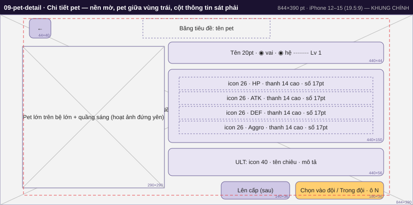

| id | x | y | w | h | loại | nội dung |
|---|---|---|---|---|---|---|
| pet.bg | 0 | 0 | 844 | 390 | img | Nền bg_pet (làm mờ 5px, tối 80%) |
| topbar.back | 60 | 8 | 44 | 40 | btn | ← |
| pet.title | 292 | 8 | 260 | 40 | text | Băng tiêu đề: tên pet |
| pet.art | 46 | 65 | 290 | 290 | img | Pet lớn trên bệ lớn + quầng sáng (hoạt ảnh đứng yên) |
| pet.header | 344 | 56 | 440 | 44 | panel | Tên 20pt · ◉ vai · ◉ hệ ········ Lv 1 |
| pet.stats | 344 | 112 | 440 | 150 | panel |  |
| pet.stat1 | 366 | 128 | 396 | 26 | text | icon 26 · HP · thanh 14 cao · số 17pt |
| pet.stat2 | 366 | 158 | 396 | 26 | text | icon 26 · ATK · thanh 14 cao · số 17pt |
| pet.stat3 | 366 | 188 | 396 | 26 | text | icon 26 · DEF · thanh 14 cao · số 17pt |
| pet.stat4 | 366 | 218 | 396 | 26 | text | icon 26 · Aggro · thanh 14 cao · số 17pt |
| pet.ult | 344 | 274 | 440 | 56 | panel | ULT: icon 40 · tên chiêu · mô tả |
| pet.levelUp | 452 | 342 | 140 | 36 | btn | Lên cấp (sau) |
| pet.toTeam | 604 | 342 | 180 | 36 | primary | Chọn vào đội / Trong đội · ô N |

## 10-settings — Cài đặt (toàn màn)
Khung 844×390 · an toàn trái 48 phải 48 trên 8 dưới 20 · 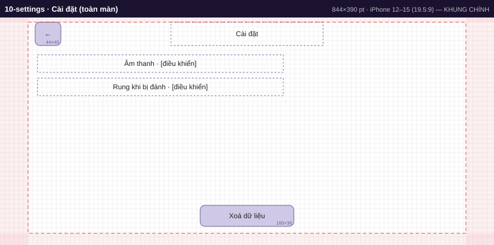

| id | x | y | w | h | loại | nội dung |
|---|---|---|---|---|---|---|
| topbar.back | 60 | 8 | 44 | 40 | btn | ← |
| settings.title | 292 | 8 | 260 | 40 | text | Cài đặt |
| settings.row1 | 64 | 64 | 420 | 30 | text | Âm thanh  ·  [điều khiển] |
| settings.row2 | 64 | 104 | 420 | 30 | text | Rung khi bị đánh  ·  [điều khiển] |
| settings.reset | 342 | 322 | 160 | 36 | btn | Xoá dữ liệu |
